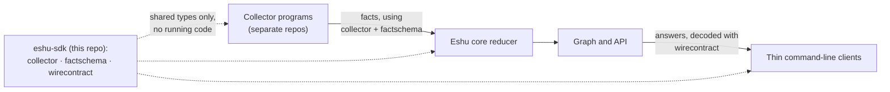

# eshu-sdk

**Status: pre-release.** The three modules here are published only as
release candidates (versions with an `-rc` suffix). A candidate being
downloadable does not mean a production Eshu system accepts it yet. The
[compatibility policy](docs/compatibility.md) records, per module, what
has actually been checked.

Shared Go libraries that let code outside Eshu core speak Eshu's data
formats without importing Eshu core itself.

## What this is and why it exists

Eshu collects facts — small, typed records about software systems, such
as "this package has this vulnerability" — from many collector programs.
Collectors and the core reducer (the part of Eshu that turns facts into
a queryable graph) must agree byte-for-byte on what a fact looks like.
This repo holds that shared agreement as three independent Go modules,
so a collector repo and Eshu core can both depend on the agreement
without depending on each other.

There is no root Go module. Each module is built, tested, and versioned
on its own, with its own `go.mod`, changelog, and tags of the form
`<module>/vX.Y.Z`. All three modules require Go 1.26.10 or newer (the
`go` line in each `go.mod`).

## Where it fits



In words: collectors emit facts shaped by the `collector` and
`factschema` modules; the core reducer reads the same shapes; API
clients decode answers shaped by `wirecontract`. This repo ships types
and validators only — nothing here runs as a service.

## The three modules

| Module | What it is for | Example imports |
| --- | --- | --- |
| `github.com/eshu-hq/eshu-sdk/collector` | The contract between an out-of-tree collector and its Eshu host: request/result records, validators, paging for large results, plus `transport` HTTP helpers, a bounded `command.Run` stdio runner, and an `entrypoints` generator that renders a collector command from a manifest. | `github.com/eshu-hq/eshu-sdk/collector`, `.../collector/transport`, `.../collector/command` |
| `github.com/eshu-hq/eshu-sdk/factschema` | One typed Go struct per fact kind (under `<family>/v1`, such as `aws/v1`), the shared `Envelope`, checked-in JSON Schemas, typed decoding, stable fact IDs (`identity`), shared test fixtures (`fixturepack`), and test assertions (`contracttest`). A missing required field is a decode error, never a silent zero value. | `github.com/eshu-hq/eshu-sdk/factschema`, `awsv1 "github.com/eshu-hq/eshu-sdk/factschema/aws/v1"` |
| `github.com/eshu-hq/eshu-sdk/wirecontract` | The API shapes a thin client needs to decode Eshu answers: the response/truth/error envelopes, query profiles, freshness values, the MCP tool-definition shape, and the client environment-variable registry with its validator. Standard library only; every JSON field is pinned to core bytes by golden files in `wirecontract/testdata/golden`. | `github.com/eshu-hq/eshu-sdk/wirecontract` |

Each module also has its own README with the full contract surface:
[collector](collector/README.md), [factschema](factschema/README.md),
and [wirecontract](wirecontract/README.md).

## When to use it, and when not to

Use these modules when you are writing a collector, a reducer, or a
client that must produce or consume Eshu fact or API formats from
outside Eshu core.

Do not use them to reach into Eshu core behavior. Admission decisions,
grants, graph writes, queues, and durable state stay in core; these
modules deliberately publish none of that (the `wirecontract` package
comment in [wirecontract/doc.go](wirecontract/doc.go) lists exactly
what is left out and why).

## Quickstart

Pick an exact candidate version first. The
[compatibility policy](docs/compatibility.md) lists checked tags and
prepared next candidates per module; use an exact version, never
`@latest`, as release evidence.

```sh
go get github.com/eshu-hq/eshu-sdk/collector@<exact-version>
go get github.com/eshu-hq/eshu-sdk/factschema@<exact-version>
go get github.com/eshu-hq/eshu-sdk/wirecontract@<exact-version>
```

Then import the packages you need:

```go
import (
    "github.com/eshu-hq/eshu-sdk/collector"
    "github.com/eshu-hq/eshu-sdk/collector/command"
    "github.com/eshu-hq/eshu-sdk/factschema"
    awsv1 "github.com/eshu-hq/eshu-sdk/factschema/aws/v1"
    "github.com/eshu-hq/eshu-sdk/wirecontract"
)
```

Before relying on a version, recheck its tag and its origin through the
public Go proxy, and build a fresh consumer with `GOWORK=off` and no
`replace` directive. The [provenance note](docs/provenance.md) records
where the code came from (Eshu commit
`eb62fa3056f5ed3518bb5aa676bf2e3adc96c1d5`), and
[docs/evidence](docs/evidence) holds the recorded consumer proofs for
specific candidates.

## How it works

- **collector** defines what a collector returns to its host and
  validates it before the host commits anything. Large results can be
  split across resumed calls (`collector-sdk/v1alpha3` paging) so one
  bounded stdout write is never exceeded. See
  [command behavior](docs/command.md) and
  [entrypoint generation](docs/entrypoints.md).
- **factschema** is the collector-to-reducer payload contract. The
  decoder hands reducer code a validated, latest-version struct per
  fact kind instead of untyped maps, and the JSON Schemas under
  `factschema/schema/` are generated from those structs and checked
  for drift in CI.
- **wirecontract** is a byte-pinned copy of the client-facing API
  shapes. Its golden-file tests fail if the copy drifts from the core
  bytes it was pinned to, so drift shows up as a red test, not a
  silent client bug.

## Configuration

These are libraries: they read no environment variables and take no
flags of their own. The one runnable tool in the tree is the
entrypoint generator, `collector/cmd/collector-entrypoints-gen`; see
[its README](collector/cmd/collector-entrypoints-gen/README.md).

## Deploy / run

There is nothing to deploy. This repo contains no service, no
`Dockerfile`, and no long-running process. You consume it as Go module
dependencies from a collector, the reducer, or a client.

## Versioning and compatibility

Old in-core module paths (`github.com/eshu-hq/eshu/sdk/go/...`) and
these new paths name different Go types; the new modules are not
drop-in replacements, and the old paths stay in place until consumer
and deployed acceptance say otherwise. Tags are immutable once
published — a fix ships as the next version, never a moved tag. The
full old/new mapping, acceptance states, and per-candidate notes live
in the [compatibility policy](docs/compatibility.md); the release
process is in [docs/release.md](docs/release.md). Do not copy a
"latest version" number from this README — check the compatibility
policy and the exact tag instead.

## Eshu dependencies

| Direction | Dependency | Notes |
| --- | --- | --- |
| This repo → Eshu core | None at build time | No module imports Eshu core internals; that separation is the point of the repo ([AGENTS.md](AGENTS.md)). |
| This repo → third party | `gopkg.in/yaml.v3` (collector), `github.com/invopop/jsonschema` (factschema) | From each module's `go.mod`. `wirecontract` has no third-party requirements. |
| Eshu parts → this repo | Collector repos, the core reducer, thin API clients | Intended consumers per the package docs; which exact versions each consumer has accepted is recorded in the [compatibility policy](docs/compatibility.md), not here. |

## Development

Run the full local check before pushing:

```sh
make pre-push   # build, test, vet, lint, tidy, generation drift, file cap
```

`make ci` runs the wider set (race tests with coverage floors,
`govulncheck`, shell and workflow checks). `GOWORK=off` is used
throughout so each module proves it works independently. To check one
module: `cd factschema && GOWORK=off go test ./... -count=1`. Contract
changes need updated tests, schemas, and fixtures in the same change.
Repo rules for contributors and agents are in [AGENTS.md](AGENTS.md).

## Docs and related repos

- [Compatibility policy](docs/compatibility.md) — candidate status and
  acceptance states.
- [Release and acceptance checklist](docs/release.md) — how a tag is
  cut and proved.
- [Provenance](docs/provenance.md) — source mapping from Eshu core.
- [Command behavior](docs/command.md) and
  [entrypoint generation](docs/entrypoints.md) — collector runtime
  contracts.
- Eshu core (`eshu-hq/eshu`) owns the original payload contract
  (Contract System v1) and the host, reducer, and API that consume
  these modules.

## License

MIT — see [LICENSE](LICENSE). There is no separate `CONTRIBUTING.md`
or `SECURITY.md` in this repo; contribution rules are in
[AGENTS.md](AGENTS.md).
