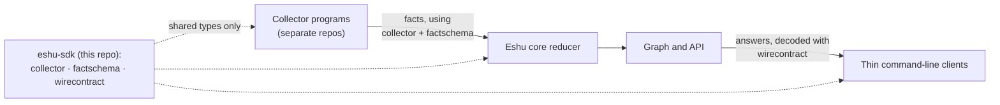

# eshu-sdk

Status: pre-release. The modules here ship only as release candidates
(versions with an `-rc` suffix). A candidate you can download isn't
automatically one a production Eshu system accepts. The
[compatibility policy](docs/compatibility.md) says, per module, what's
actually been checked.

In short: these are the shared Go libraries that let code outside Eshu
core speak Eshu's data formats without importing core itself. Eshu
collects facts, small typed records about software systems, from many
collector programs. Collectors and the core reducer (the part that
turns facts into a queryable graph) have to agree byte-for-byte on what
a fact looks like. This repo holds that agreement as three independent
Go modules. There's no root module and nothing here runs as a service.



Collectors emit facts shaped by `collector` and `factschema`, and the
reducer reads those same shapes. API clients decode answers with
`wirecontract`. You only get types and validators here, no running code.

## When it fits, and when it doesn't

Reach for these modules when you're writing a collector, a reducer, or
a client that has to produce or consume Eshu fact or API formats from
outside core.

Don't use them to reach into core behaviour. Admission, grants, graph
writes, queues, and durable state stay in core on purpose. The package
comment in [wirecontract/doc.go](wirecontract/doc.go) lists exactly
what's left out and why.

## Shortest path in

All three modules need Go 1.26.10 or newer (check the `go` line in each
`go.mod`). Pick an exact candidate version from the
[compatibility policy](docs/compatibility.md) first. Never use
`@latest` as release evidence.

```sh
go get github.com/eshu-hq/eshu-sdk/collector@<exact-version>
go get github.com/eshu-hq/eshu-sdk/factschema@<exact-version>
go get github.com/eshu-hq/eshu-sdk/wirecontract@<exact-version>
```

Then import what you need. [Getting started](docs/getting-started/README.md)
has the per-module imports and the version check worth doing before
you rely on a tag. [Reference](docs/reference/README.md) covers how the
old in-core module paths relate to these.

## Documentation

| Doc | What's in it |
| --- | --- |
| [Docs index](docs/README.md) | Every docs section and detailed contract page, grouped |
| [Getting started](docs/getting-started/README.md) | Pick an exact version, `go get` it, and make a first import |
| [Guides](docs/guides/README.md) | Wire up a collector; decode facts and API answers |
| [Concepts](docs/concepts/README.md) | The three contracts and where each one stops |
| [Reference](docs/reference/README.md) | Module table, imports, dependencies, and versioning as it's actually practised |
| [Diagrams](docs/diagrams/README.md) | Every diagram, each with a plain-text version |
| [Compatibility policy](docs/compatibility.md) | Candidate tags, checked versions, and acceptance state per module |
| [Command behaviour](docs/command.md) | How a collector command swaps one JSON request and result with a core host |
| [Entrypoint generation](docs/entrypoints.md) | How the SDK renders a stdio collector command from a provider handler |
| [Conformance grants](docs/conformance-grants.md) | How trusted core fact context lets conformance checks cover reserved fact kinds |
| [Collector README](collector/README.md), [factschema README](factschema/README.md), [wirecontract README](wirecontract/README.md) | The full contract surface for each module |
| [Entrypoint generator README](collector/cmd/collector-entrypoints-gen/README.md) | The one runnable tool in the tree |
| [Identity migration](docs/identity-migration.md) | Where `StableID` came from in core and how it landed in `factschema/identity` |
| [Contracttest migration](docs/contracttest-migration.md) | How the generic contract helpers moved into `factschema/contracttest` |
| [Migration evidence](docs/sdk-migration-evidence.md) and [evidence notes](docs/evidence) | Recorded comparisons and consumer proofs for specific candidates |
| [Provenance](docs/provenance.md) | Which Eshu commit this code came from, file by file |
| [Release checklist](docs/release.md) | How a tag gets cut and proved in CI |

## Related repos

Eshu core (`eshu-hq/eshu`) owns the original payload contract and the
host, reducer, and API that use these modules. Collector repos and thin
API clients sit on the other side and import them.

## Development

Run `make pre-push` before you push. It builds, tests, vets, lints, and
checks tidy state, generation drift, and the file cap, with `GOWORK=off`
so each module proves it stands alone. More detail lives in
[AGENTS.md](AGENTS.md).

## Contributing, security, and licence

There's no separate `CONTRIBUTING.md` or `SECURITY.md` here, so use
[AGENTS.md](AGENTS.md) for the contribution rules. The licence is MIT,
in [LICENSE](LICENSE).
