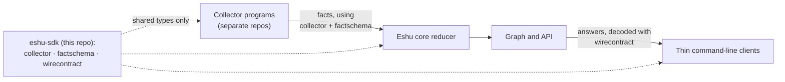
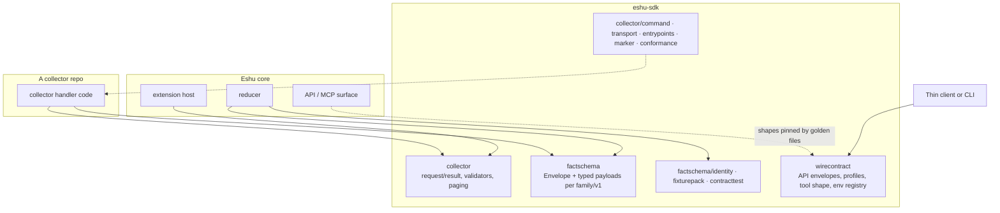
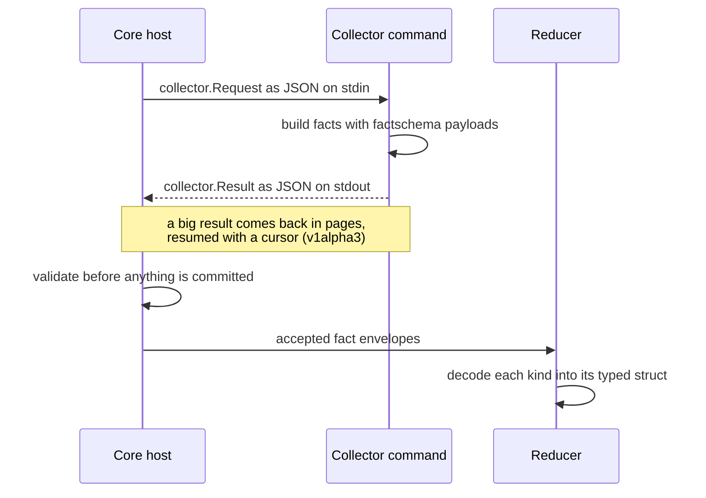

# Diagrams

Every diagram for eshu-sdk lives on this page. Other pages link here
instead of embedding their own copies. The repo [README](../../README.md)
keeps the first diagram only.

## Where the SDK sits

Collectors emit facts shaped by `collector` and `factschema`, the
reducer reads those same shapes, and API clients decode answers with
`wirecontract`. You only get types and validators here, no running code.

Text version: Collector programs send facts (shaped by `collector` +
`factschema`) to the Eshu core reducer. The reducer feeds the graph
and API. Thin clients decode API answers with `wirecontract`. This
repo supplies shared types to all three sides and runs nothing itself.

## Who imports what

A collector builds its result with `collector` and fills fact payloads
from `factschema`. Core reads the same two modules on its side of the
wire. A client decodes API answers with `wirecontract`, which core
doesn't import at all.

Text version: Collector handler code imports `collector` and
`factschema`. In core, the extension host imports `collector` and the
reducer imports `factschema` (including `identity`, `fixturepack`,
`contracttest`). The API/MCP surface does not import `wirecontract`;
its shapes are pinned to it by golden files. Thin clients import
`wirecontract`. The `collector` subpackages support the handler code.

## How a call moves

The host sends one request and reads one result per call. Validators
run before anything is committed, and big results come back in pages.

Text version: (1) Core host sends `collector.Request` JSON on stdin.
(2) The collector builds facts with `factschema` payloads. (3) It
returns `collector.Result` JSON on stdout, paged with a resume cursor
if large. (4) The host validates before committing. (5) Accepted
envelopes go to the reducer, which decodes each kind into its typed
struct.
